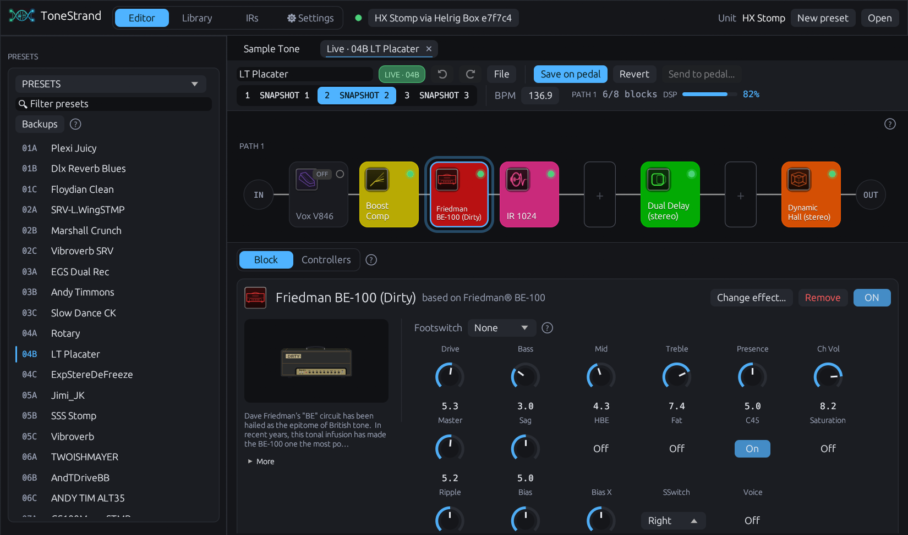
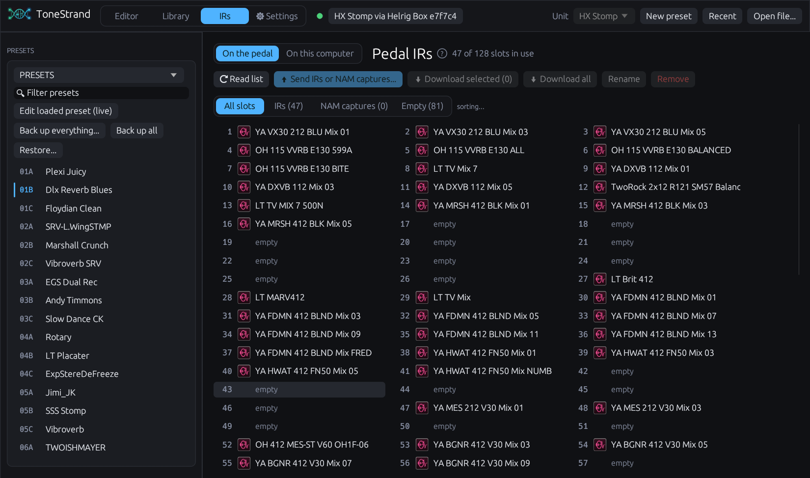
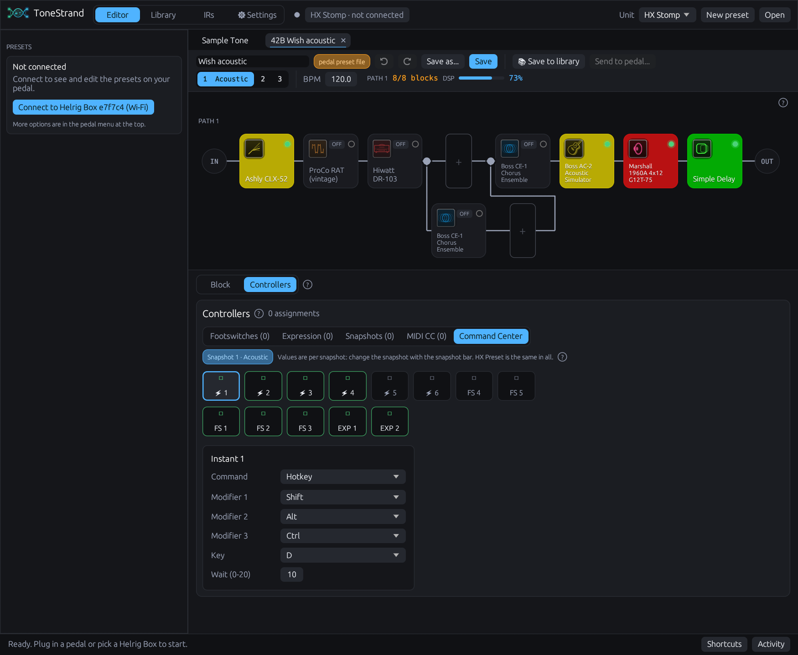
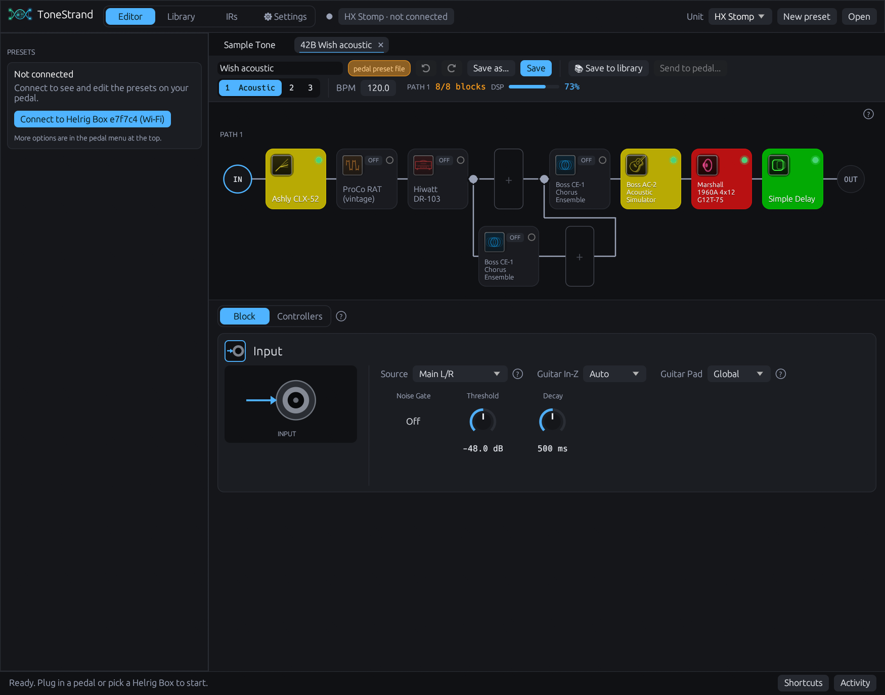
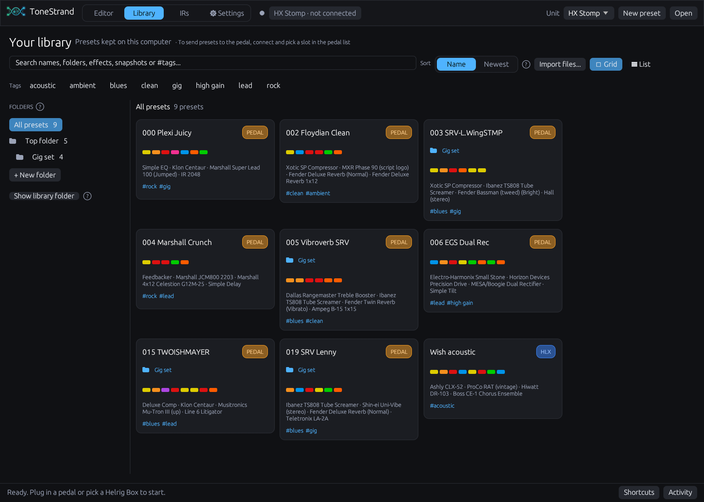

# ToneStrand

A desktop preset editor for Line 6 Helix-family pedals (HX Stomp, HX Stomp XL, HX Effects,
Helix Floor / LT / Rack), connected over **USB** or wirelessly through a **Helrig Box**.

Written in Rust with [egui](https://github.com/emilk/egui) / eframe. One self-contained
program; no account, no cloud, nothing leaves your computer.

> **Requires Line 6's HX Edit.** ToneStrand needs [HX Edit](https://line6.com/software/)
> installed on the same computer, with no exceptions. It reads the effect names, knob names and
> ranges, and categories from HX Edit's own files; the pedal itself only stores numbers.
> Without HX Edit the editor is mostly empty. Nothing from HX Edit is copied into this
> repository.



*Editing the preset loaded on an HX Stomp, connected through a Helrig Box: the pedal's preset
list on the left, the signal chain on top, the selected effect's knobs below, snapshots and
the DSP meter above the chain. Every change is heard at once.*



*The pedal's User IRs: which of the 128 slots are in use, with download, rename, remove and
"Send IRs or NAM captures" (the slot is backed up first).*



*The Command Center of an HX Stomp preset: what each instant command, footswitch and expression pedal does,
with the command's own fields, a Momentary switch where the command has one, and values kept per snapshot.*



*The input and output blocks have the same layout as an effect: a picture on the left, the settings on the right.
The guitar input impedance and pad are settings of the preset and sit here.*



*The library: presets kept on this computer, in folders you make, searchable by name, effect, snapshot name or
tag (right-click a preset to tag it).*

The effect pictures and names come from Line 6; see "Third-party material" below.

## What it does

- **Live editing** of the preset loaded on the pedal: every knob, switch, effect swap, move,
  split/merge and snapshot change is heard at once; "Save on pedal" keeps it.
- **Offline editing** of `.hlx` files (the JSON format Helix editors export) and of the pedal's
  own documents (`.hxpreset`), with undo/redo, and sending them to any slot (the slot is backed
  up first). A pedal preset can be made into a `.hlx` ("Make .hlx"), also fitted to another unit (a Stomp preset for a Helix gets its second path to fill).
- **Signal chain** drawn as a diagram: drag to move, click the line between effects to split
  there or add an effect / FX loop / send / return, right-click menus, keyboard shortcuts
  (Space on/off, Enter change, Delete remove, arrows to select); Ctrl+O / N / W, Ctrl+Tab for
  presets, F2 to rename, Ctrl+S to save, Ctrl+Z / Y for undo and redo; F1 lists them all.
- **Pedal presets**: drag one preset onto another slot to copy, swap or move it (the slot it
  replaces is backed up first and the write is read back).
- **Snapshots**: recall, rename, copy (on the live preset too, with the pedal's own copy and paste), duplicate, delete; per-snapshot knob values.
- **Controllers**: footswitches, expression pedals, snapshots and MIDI CC, on files and live on the pedal.
- **Command Center**: all of it in `.hlx` files; on the pedal (HX Stomp), a trigger grid with an editor for every
  command type, a Momentary switch where the command has one, values per snapshot, in a file or live on the loaded
  preset (the pedal's own requests, checked by reading back). A `.hlx` sent to the pedal carries its Command Center.
  The other units' layouts come from the documentation and are marked as not checked.
- **Compare two presets** (files, open tabs or a slot's preset) and **restore** a backed-up preset or a
  whole-pedal backup, after a list of what it holds.
- **Preset library** on disk (real folders) with tags and search (names, effects, snapshot names, tags), import of HX Edit backups (`.hxb`) and setlists
  (`.hls`), conversion between units with a report of what doesn't fit.
- **User IRs**: list, upload (any `.wav`, resampled to the pedal's format), download, rename,
  remove; IRs and NAM captures are told apart.
- **NAM A2 Lite** (optional community firmware for HX Stomp / XL / HX Effects): the block's
  knobs and capture picker, and a converter from `.nam` captures to the `.wav` the block loads.
- Effect photos and descriptions, real-gear names (optional), effect-type icons, DSP estimate
  per path, a dark or light look (or follow the computer), and a choice of accent colour in Settings.
- **Problem report** (Activity menu): a folder in Downloads with the log, version, unit and what has been checked on it,
  and optionally the open preset; nothing is sent anywhere. The first time a unit connects, a notice says what has
  been tried on it (only the HX Stomp so far).
- A hidden **self-test** page (Ctrl+Shift+T) that exercises every pedal operation on one slot
  and one IR slot, with backups and automatic restore.

## Requirements

- **HX Edit installed** on the same computer (required). ToneStrand reads effect names, knob names and
  ranges from HX Edit's resource files at start-up (`Helix.sym`, `*.models`,
  `HelixControls.json`, ...). Nothing from HX Edit is copied into this repository. If HX Edit
  is in an unusual place, set its folder in Settings.
- A Helix-family pedal on USB, or a paired Helrig Box with the pedal plugged into it.
- To build: Rust (stable). See [docs/BUILDING.md](docs/BUILDING.md).

## Download

Get the latest Windows build (a beta is marked as a pre-release) from the [Releases](https://github.com/radioactivetoy/ToneStrand/releases)
page, in either form:

- **`ToneStrand-Setup-<version>.exe`**: the installer. It installs for your user only (no
  administrator rights), adds a Start menu entry and an uninstaller.
- **`ToneStrand-<version>-windows.zip`**: portable. Unzip anywhere and run `tonestrand.exe`.

You also need [HX Edit](https://line6.com/software/) installed (see above). The program isn't
code-signed, so Windows SmartScreen may warn the first time: choose **More info**, then
**Run anyway**. Only Windows has been tried. On a Mac you can build from source (CI builds it; nobody has run it). Linux is not supported: the effect list comes from HX Edit's files, and there is no HX Edit for Linux.

## Quick start (build from source)

```sh
cargo run --release
```

The release binary is `target/release/tonestrand(.exe)`.

## Your settings file

ToneStrand keeps its settings in `%APPDATA%\ToneStrand\settings.json` (on macOS and Linux, in
the system's config folder). When you pair a Helrig Box, the secret **pairing token** the box
gives this computer is stored in that file as plain text. Anyone who has a copy can control
that box from the same network, for example to send presets to the pedal.

**Don't share `settings.json`**, in bug reports, screenshots, chat or a public repository.
"Forget" next to a box under Settings removes its token from this computer only; it does not
necessarily make the box reject that token. If a copy may have leaked, also reset the box's
pairings as the box's own documentation describes, then pair again.

## Documentation

| File | For |
|---|---|
| [docs/BUILDING.md](docs/BUILDING.md) | Toolchains, platform requirements, build and test commands |
| [docs/ARCHITECTURE.md](docs/ARCHITECTURE.md) | How the program is organised: modules, threads, data flow, UI |
| [docs/PROTOCOL.md](docs/PROTOCOL.md) | The pedal's USB protocol and the Helrig Box relay |
| [docs/FILE_FORMATS.md](docs/FILE_FORMATS.md) | Preset documents, `.hlx`, `.hxb`/`.hls`, IR `.wav`, NAM conversion |
| [docs/COMMAND_CENTER.md](docs/COMMAND_CENTER.md) | Command Center: slots, command types, document layout, live editing |
| [AGENTS.md](AGENTS.md) | Working rules and checklists for coding agents (Claude, Antigravity, ...) |

## Status

**Beta.** Built and checked on an HX Stomp; the other units are supported from their documented layouts
and have not been tried on real hardware, so back up before writing to them.

Used daily on an HX Stomp, over USB and through a Helrig Box (live editing, IR upload and
preset writes have been exercised with the self-test). Things not yet tried on real hardware
are listed in [AGENTS.md](AGENTS.md#known-gaps-and-unverified-areas).

## Third-party material and trademarks

ToneStrand is a free, non-commercial project. It is not affiliated with, endorsed by or
supported by Line 6, Yamaha Guitar Group, or the makers of the Helrig Box.

### Line 6 material

- **Effect photos and descriptions** (`assets/models/`) are taken from Line 6's firmware
  release notes.
- **Effect-type icons** (`assets/block Images/`) are Line 6 artwork from HX Edit / Helix Stadium.

This material is © Yamaha Guitar Group, Inc. (Line 6) and remains theirs. It is included free of
charge, only to show which effect is which, and nothing in ToneStrand is sold.

**Removal on request:** if you hold rights to any of this material and want it removed,
please [open an issue](https://github.com/radioactivetoy/ToneStrand/issues) and it will be
taken down promptly.

### Trademarks and model names

- Line 6, Helix, HX Stomp, HX Stomp XL, HX Effects, HX Edit, and the names of Line 6's
  amp, cab and effect models are trademarks of Yamaha Guitar Group, Inc. They are used here
  only to name the devices and effects ToneStrand works with.
- **Real gear names** (an optional setting, e.g. "based on Fender® Deluxe Reverb®") are
  trademarks of their respective owners. Those owners are not associated with Line 6 or with
  ToneStrand and have not endorsed either. The names are used only to describe the sound each
  model is designed to recall, and in this project's own words.
- Helrig Box is the name of its makers' product and is used only to say ToneStrand works with it.
  See the box's build guide at [box.helrig.com](https://box.helrig.com/), its repository
  [maveric1977/helrig-box](https://github.com/maveric1977/helrig-box), and the open-source
  [ToneRelay](https://github.com/mpeskett88/ToneRelay) Wi-Fi relay by Mark Peskett that its
  firmware is built on.

### Other sources

- The NAM converter follows the published file layout of
  [hx-stomp-nam-lite](https://github.com/nocaseguy/hx-stomp-nam-lite) (GPL-3; layout read, no
  code copied). The Helrig Box relay follows the box's public relay protocol description (MIT); see the
  [helrig-box](https://github.com/maveric1977/helrig-box) and
  [ToneRelay](https://github.com/mpeskett88/ToneRelay) projects.

## License

ToneStrand is free software: you can redistribute it and/or modify it under the terms of the
GNU General Public License as published by the Free Software Foundation, either version 3 of
the License, or (at your option) any later version. See [LICENSE](LICENSE).

The licence covers this project's own code and documentation. It does not cover the Line 6
material listed under "Third-party material and trademarks" (effect icons, photos and
descriptions), which belongs to Line 6.
